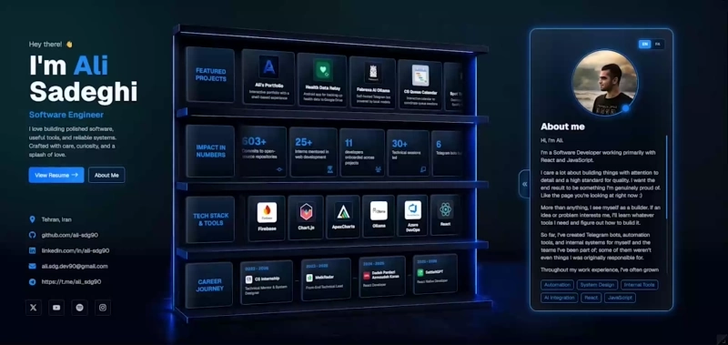
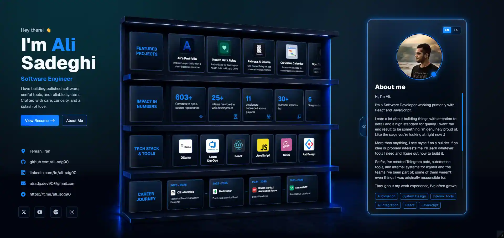
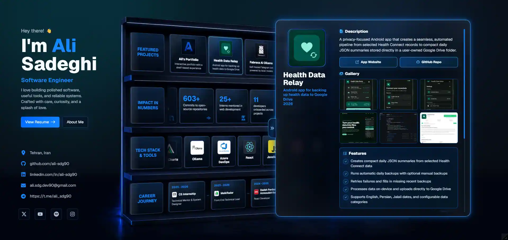
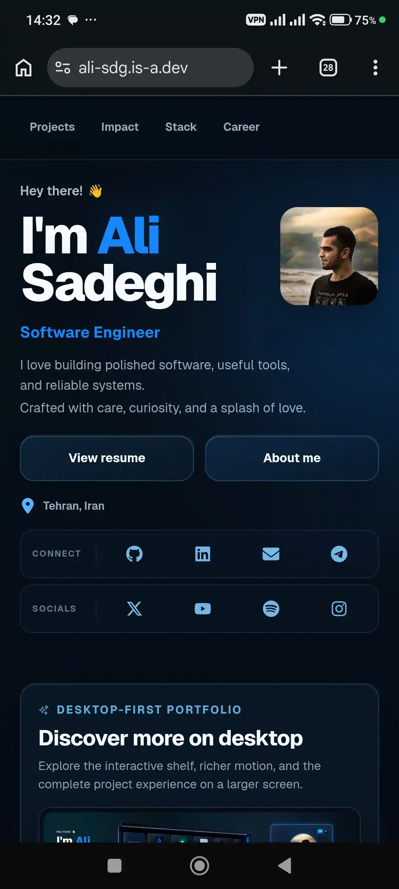
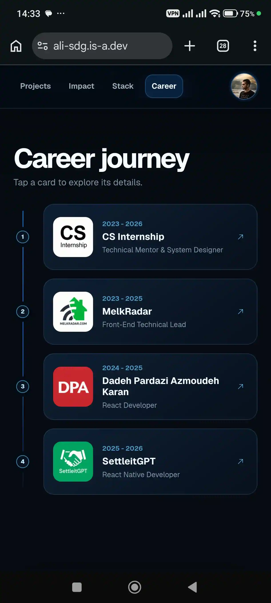
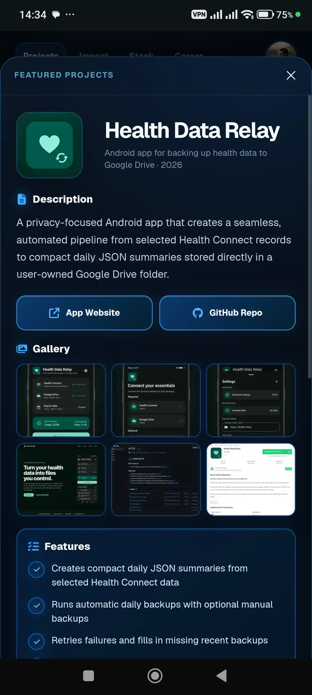
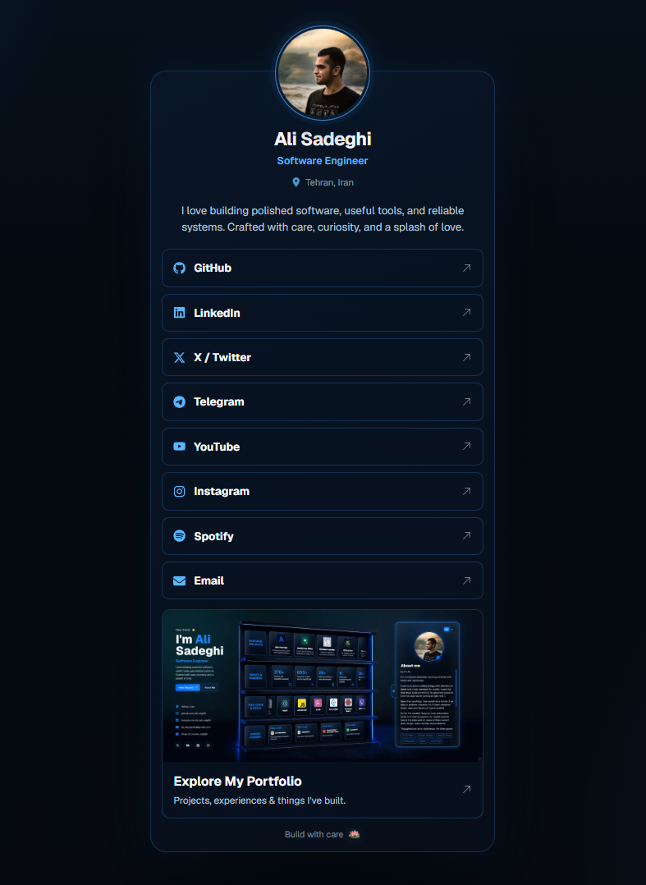
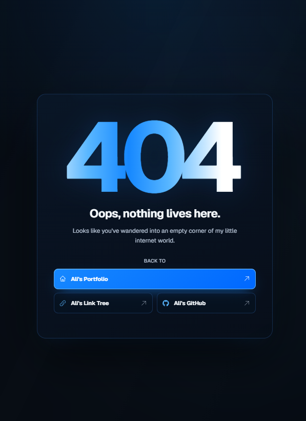

# Ali Sadeghi | Interactive Portfolio

[](https://ali-sdg.is-a.dev/)
[](https://github.com/Ali-Sdg90/ali-sdg90.github.io/actions/workflows/ci.yml)
[](https://github.com/Ali-Sdg90/ali-sdg90.github.io/releases/latest)
[](#license)

**[Explore the portfolio ↗](https://ali-sdg.is-a.dev/)** · **[See how I built it ↗](https://ali-sdg.is-a.dev/how-i-built-my-portfolio)**

[](https://ali-sdg.is-a.dev/)

## A little world of my own

For a long time, I wanted a portfolio of my own, but I never quite had the time, the reason, or the right idea to build one. When the moment finally came, I knew I didn't want it to be just another ordinary portfolio.

The things I build reflect a part of who I am. They're things I create and share with the world, and I wanted this portfolio to be something I could genuinely love and feel proud of.

Then came the idea of a shelf. A beautiful, carefully crafted space where my projects could sit like books in a library. Each book would have its own story, personality, and reason for existing.

Over roughly five months, that idea grew from the first line of code into a 3D shelf, a mobile experience, and countless little details and features along the way. Building it was such a lovely journey that I decided to share the story of how it all came together here, too.

I hope you enjoy exploring my little world of creations :)

## What's inside

The shelf brings together four sides of my work:

- **Featured Projects**: selected things I've built, with their purpose, screenshots, technical context, stories, and links.
- **Impact in Numbers**: some of the outcomes that matter to me, including building useful tools, mentoring, and contributing to teams.
- **Tech Stack & Tools**: technologies I've used and the experiences I've had with them, beyond a simple list of logos.
- **Career Journey**: the roles, responsibilities, and people and projects that helped shape the way I work.

Rather than asking visitors to read everything in order, the site lets them follow their own curiosity.

## The experience

### On desktop

The main interface is a perspective-based digital shelf. Its rows have different dimensions and interaction settings, but work together as one scene.

You can move through the cards with dragging and momentum, then select one to open its details without leaving the experience. Depending on the item, the detail view can include its background, technologies, longer stories in English and Persian, a gallery, and links to explore further.

<table>
  <tr>
    <td width="50%"></td>
    <td width="50%"></td>
  </tr>
</table>

### On mobile

I didn't want the mobile version to feel like a desktop design squeezed into a smaller screen.

It has its own layout and navigation, with touch-friendly horizontal collections, focused content sections, and bottom sheets for details. It shares the same stories and visual identity as desktop, while approaching the interactions differently where it makes sense.

<table>
  <tr>
    <td width="33%"></td>
    <td width="33%"></td>
    <td width="33%"></td>
  </tr>
</table>

## How it came to life

This project went through quite a few versions before it became what it is today.

I tried different layouts, experimented with perspective and movement, changed how details opened, rethought the mobile experience, and spent more time than I expected on images, accessibility, and all the small choices that make an interface feel right.

I wanted to remember that process, including the ideas I didn't keep.

So I made **How My Portfolio Was Built**, a 34-slide visual journal available in **English and Persian**. It brings together early sketches, experiments, rejected approaches, design decisions, technical challenges, and the thinking behind the final experience.

The journal is part of the site itself, with its own page-turn interaction, chapter navigation, and images from the journey.

**[Read the full build story ↗](https://ali-sdg.is-a.dev/how-i-built-my-portfolio)**

## Technical highlights

Beyond the visual experience, this portfolio includes a few engineering details I'm particularly happy with.

- **Hybrid SSG & CSR:** Build-time prerendering with React 19, hydration for the mobile experience, and client-side rendering for the interactive desktop interface.
- **No-JavaScript Fallback:** Prerendered portfolio content remains readable, styled, and scrollable when JavaScript is unavailable.
- **Perspective-Based 3D Shelf:** A configurable shelf system built with CSS perspective, 3D transforms, container query units, and aspect-ratio-aware layout adjustments.
- **Custom Shelf Scrolling Physics:** Drag interactions, momentum, friction, automatic scrolling, and seamlessly looping card rows.
- **Purpose-Built Mobile Experience:** A separate mobile interface with scroll-aware navigation, swipeable project cards, animated avatar transitions, and detail bottom sheets.
- **Custom Page-Peel Animation:** A page-turn transition built with geometry calculations, Bézier curves, and dynamic CSS clip paths instead of a page-flip library.
- **Interactive Image Lightbox:** High-resolution image previews with zoom, panning, keyboard controls, and touch-based pinch gestures.
- **Automated Image Pipeline:** Sharp-based WebP generation with configurable presets, thumbnail and high-resolution variants, and SHA-256 processing caches.
- **Bilingual, Data-Driven Content:** Shared structured data and separate English and Persian Markdown stories across projects, tech stack, impact, and career entries.
- **Shareable Deep Links:** URL-based navigation for opening specific portfolio cards, sections, and the build story directly.
- **Accessible Interaction Patterns:** Semantic controls, keyboard interaction, focus management, accessible dialogs, inert background states, and reduced-motion support.
- **Machine-Readable Content:** Semantic HTML, structured metadata, robots directives, a sitemap, and supplementary `llms.txt` and Markdown resources.
- **Automated Delivery & Analytics:** GitHub Actions CI/CD, isolated pull-request previews, semantic releases, GitHub Pages deployment, and production-only Umami tracking.

## Beyond the main page

I also built a small [Links page](https://ali-sdg.is-a.dev/links) and a custom [404 page](https://ali-sdg.is-a.dev/404.html).

They're simpler parts of the site, but I wanted them to have the same attention to detail and feel like they belong here.

<table>
  <tr>
    <td width="50%" align="center">
      <a href="https://ali-sdg.is-a.dev/links">
        
      </a>
    </td>
    <td width="50%" align="center">
      <a href="https://ali-sdg.is-a.dev/404.html">
        
      </a>
    </td>
  </tr>
</table>

## Technology

The tools matter, but I see them as choices that help bring the idea to life.

| Area               | Technology                          | What it does here                                                                      |
| ------------------ | ----------------------------------- | -------------------------------------------------------------------------------------- |
| Interface          | React 19                            | Components, state, and the interactive experience                                      |
| Build tooling      | Vite 8                              | Local development, client and SSR builds, prerendering, and multiple HTML entry points |
| Styling            | SCSS                                | Perspective, layouts, responsive behavior, and visual details                          |
| Motion             | Framer Motion + CSS                 | Transitions, gestures, and custom interactions                                         |
| Image processing   | Sharp                               | Optimized WebP generation and cached image processing                                  |
| Code quality       | ESLint, Prettier, Husky, Commitlint | Code consistency and commit checks                                                     |
| Release automation | semantic-release                    | Versions, changelogs, tags, and releases                                               |
| Delivery           | GitHub Actions + GitHub Pages       | Automated builds, pull-request previews, and deployment                                |
| Analytics          | Umami                               | Measuring useful interactions in production                                            |

## Quality and delivery

I wanted this to be something I could keep improving, not just something that looked good on launch day.

That has meant revisiting performance, deferring heavier content when appropriate, keeping image sizes under control, checking interactions across screen sizes, and paying attention to accessibility and motion preferences.

The repository uses automated tooling for formatting, linting, image processing, client and SSR builds, prerendering, and releases. Pull requests from branches in this repository can receive isolated GitHub Pages previews. Changes merged into `main` go through the release and deployment workflow, with semantic-release creating a new version when the commits call for one.

## Run it locally

### Requirements

- Node.js 20.19+ or a newer supported version
- npm

### Setup

```bash
git clone https://github.com/Ali-Sdg90/ali-sdg90.github.io.git
cd ali-sdg90.github.io
npm ci
npm run dev
```

### Available commands

| Command             | Purpose                                                                             |
| ------------------- | ----------------------------------------------------------------------------------- |
| `npm run dev`       | Start the development server                                                        |
| `npm run dev:debug` | Start a fixed-port local server for debugging                                       |
| `npm run mobile`    | Make the development server available on your local network                         |
| `npm run image:opt` | Generate optimized images from `image-sources/`                                     |
| `npm run test`      | Run the unit and component test suite once                                          |
| `npm run test:e2e`  | Run the Playwright browser tests against the production preview                     |
| `npm run check`     | Check formatting and linting, run tests, then run the full production build         |
| `npm run build`     | Optimize images, build client and SSR bundles, and prerender the portfolio homepage |
| `npm run preview`   | Preview the generated production output locally                                     |

## Still growing

I don't think of this as a finished collection of everything I've done.

New projects will find their way onto the shelf. Older ones might get new stories. And as I learn and change, I expect this space to change with me.

If you've taken the time to explore it, thank you. I hope it gives you a sense of both **what I build** and **why I enjoy building it**.

## License

Copyright © 2026 Ali Sadeghi. All rights reserved.

This repository is publicly available for viewing, personal study, and educational reference. It is **source-available, not open source**.

The code, design, structure, written content, branding, résumé, photographs, and other assets may not be copied, redistributed, deployed, or used to create a substantially similar portfolio without prior written permission.

See [LICENSE](./LICENSE) for the complete terms.

_Made with love ❤️_
