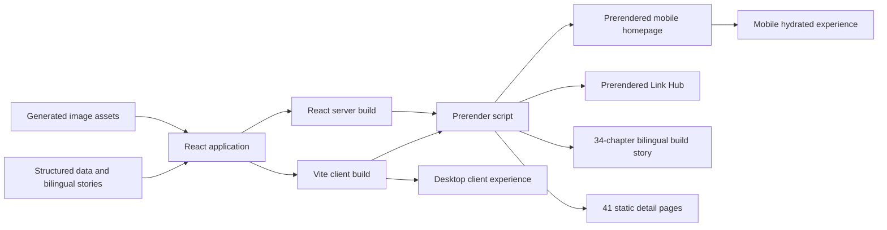

# Architecture

This document describes the production architecture of Ali Sadeghi's
interactive portfolio. It focuses on the boundaries that matter when changing
rendering, routing, content, or delivery. Component-level implementation details
remain in the source code.

## System overview

The portfolio is a React 19 and Vite 8 application with two purpose-built user
experiences:

- Desktop uses the interactive 3D shelf and client-side rendering.
- Mobile uses a separate touch-oriented interface and build-time prerendering.

Both experiences read the same structured portfolio data. The build also turns
every visible shelf card into an independent static detail page.



## Source-of-truth boundaries

| Concern                                               | Source of truth                                         |
| ----------------------------------------------------- | ------------------------------------------------------- |
| Shelf sections, card order, labels, and card metadata | `src/data/portfolio/shelfSections.js`                   |
| Project detail content                                | `src/data/aboutSection/aboutProjectData.js`             |
| Impact detail content                                 | `src/data/aboutSection/aboutImpactData.js`              |
| Technology detail content                             | `src/data/aboutSection/aboutTechStackData.js`           |
| Career detail content                                 | `src/data/aboutSection/aboutCareerData.js`              |
| Bilingual long-form stories                           | `src/data/stories/{en,fa}/`                             |
| Project gallery mappings                              | `src/data/aboutSection/projectGalleryData.js`           |
| About Me and profile links                            | `src/data/portfolio/aboutData.js` and `profileLinks.js` |
| Build-story chapters                                  | `src/data/howItWasBuilt/howItWasBuiltData.js`           |
| Original image inputs                                 | `image-sources/`                                        |
| Generated application images                          | `src/assets/images/`                                    |
| Public static files                                   | `public/`                                               |

Content should be changed in these data sources rather than hard-coded into
desktop, mobile, or static-detail components.

## Application entry points

Vite builds five HTML entry points from `vite.config.js`.

| Route                        | Entry                                                    | Runtime behavior                                                                    |
| ---------------------------- | -------------------------------------------------------- | ----------------------------------------------------------------------------------- |
| `/`                          | `index.html` and `src/main.jsx`                          | Prerendered mobile HTML, then mobile hydration or desktop client rendering          |
| `/how-i-built-my-portfolio/` | `how-i-built-my-portfolio/index.html` and `src/main.jsx` | All 34 bilingual chapters are prerendered, then replaced by the interactive gallery |
| `/links`                     | `links/index.html` and `src/links/main.jsx`              | Prerendered Link Hub hydrated by its independent client entry                       |
| `/404.html`                  | `404.html` and `src/notFound/main.jsx`                   | Independent noindex 404 experience                                                  |
| `/{section}/{id}/`           | `static-detail-template.html`                            | Build-generated static HTML for each shelf card                                     |

Static detail sections use the `projects`, `impact`, `stack`, and `career`
route segments.

GitHub Pages serves the dedicated `404.html` entry for missing routes. If the
main entry is loaded on an unsupported path, `src/main.jsx` also falls back to
the same noindex 404 experience.

## Homepage rendering

`src/entry-server.jsx` renders `<App />` through React's
`prerenderToNodeStream`. The server snapshot in `useMobileViewport` deliberately
returns `true`, so server rendering is deterministic and always produces the
mobile portfolio.

`scripts/prerender.mjs` then:

1. Reads the client-built homepage, Link Hub, build-story, and detail-template documents.
2. Imports the temporary server bundle from `dist-ssr/entry-server.js`.
3. Validates the homepage sections, Link Hub content, and all 34 bilingual story chapters.
4. Replaces each empty root with its build-time content.
5. Generates the static detail documents.
6. Removes the temporary template and `dist-ssr` directory.

At runtime, `src/main.jsx` applies the viewport boundary at `899px`:

- At `899px` or below, React hydrates the matching mobile markup.
- Above `899px`, the prerendered mobile root is cleared and the desktop
  application is client-rendered.

This is progressive enhancement, not crawler-only content. A browser without
JavaScript receives useful mobile portfolio content and normal links to the
static detail pages. JavaScript adds the viewport-specific interactive
experience.

The Link Hub hydrates its matching prerendered component. The build-story route
starts as a visible linear document with every English and Persian chapter,
then JavaScript replaces it with the existing focused gallery. This makes the
complete story crawlable without maintaining a duplicate text source.

## Static detail pages

`src/staticDetails/staticDetailPages.js` joins every item in `shelfSections`
with its matching detail-data record. The current inventory is:

- 11 project pages under `/projects/`
- 9 impact pages under `/impact/`
- 17 technology pages under `/stack/`
- 4 career pages under `/career/`

Each generated page includes semantic content, English and Persian stories,
page-specific metadata, a canonical URL, Open Graph and Twitter metadata,
JSON-LD, related links, and a path back to the interactive portfolio.

Card links use these real routes. An ordinary click is intercepted to open the
interactive detail view, while modified clicks and no-JavaScript navigation
continue to the static page.

The route inventory is derived from shared data, but `public/sitemap.xml` is a
tracked public file. When cards are added, removed, or renamed, keep its detail
routes synchronized.

## Navigation and URL contracts

`usePortfolioHashNavigation` owns interactive portfolio state:

- `/` is the shelf home.
- `/#<item-id>` opens a shelf item.
- `/how-i-built-my-portfolio/` opens the build story.
- The legacy `#shelf` and `#how-i-built-my-portfolio` forms are normalized.
- Invalid hashes return to the shelf without creating a second content source.

`VITE_BASE` allows the same routing and asset logic to work in GitHub Pages pull
request previews such as `/pr-preview/pr-42/`. Production canonical URLs remain
root-based.

## Code and styling organization

- `src/components/DesktopPortfolio/` composes the desktop experience.
- `src/components/MobilePortfolio/` owns the dedicated mobile experience.
- Shared detail, story, gallery, and lightbox behavior lives under
  `src/components/AboutPanel/`.
- `src/staticDetails/` renders the linear static version of shared card data.
- Global SCSS variables and foundations live in `src/assets/scss/base/`.
- Component styles live in focused partials under
  `src/assets/scss/components/`.

Desktop and mobile intentionally share data and reusable behavior, but they do
not share one responsive layout. Preserve that boundary unless a change is
explicitly intended for both experiences.

## Build and delivery

The production build is:

```text
npm run build
  -> npm run image:opt
  -> vite build
  -> vite build --ssr src/entry-server.jsx --outDir dist-ssr
  -> node scripts/prerender.mjs
```

`npm run generate:ssg` runs the client build, server build, and prerendering
without rerunning image optimization.

GitHub Actions uses this delivery path:

```text
build -> end-to-end tests -> pull-request preview
                          -> semantic release -> production deployment
```

The build artifact is uploaded once and reused by end-to-end tests and the
production deploy job. Pull requests from branches in this repository receive
base-path-aware previews on `gh-pages`. A push to `main` deploys only when
Semantic Release creates a new release.

`CHANGELOG.md`, package versions, tags, and GitHub releases are owned by
Semantic Release and should not be edited manually.

## Analytics and machine-readable content

The portfolio, build-story, and links HTML entries inject Umami only on the
production hostname. Local tracking remains disabled unless explicitly enabled
in the relevant entry. The 404 entry does not load analytics.

Search engines and non-JavaScript readers are supported through:

- Prerendered homepage content
- Prerendered Link Hub content
- All 34 English and Persian build-story chapters
- Static card detail routes
- Canonical, robots, social, and structured metadata
- `public/sitemap.xml` and `public/robots.txt`
- `public/llms.txt` and the supporting files under `public/llms/`

Machine-readable summaries supplement the application. They do not replace the
structured portfolio data as the implementation source of truth.

## Architectural invariants

Changes should preserve these contracts:

1. Desktop and mobile use the same portfolio data.
2. Server rendering stays deterministic and browser-safe.
3. The mobile homepage can hydrate without a markup mismatch.
4. Desktop replaces, rather than hydrates, the prerendered mobile tree.
5. The complete build-story fallback and interactive gallery use the same chapter data.
6. Every visible shelf item resolves to complete detail data and a static page.
7. IDs remain stable because they are used in hashes, routes, stories, tests,
   and sitemap entries.
8. Generated files in `dist` and `dist-ssr` are never edited directly.
9. Static content remains useful without JavaScript and is not crawler-only.

## Verification

Run the complete local gate after architecture, routing, data, or build changes:

```bash
npm run check
```

For changes that affect critical browser journeys, also run:

```bash
npm run build
npm run test:e2e
```

See [Testing Strategy](./testing.md) for the protected contracts and
[Static Site Generation Architecture](./ssg-architecture.md) for the complete
build-time rendering model and raw-HTML verification.
